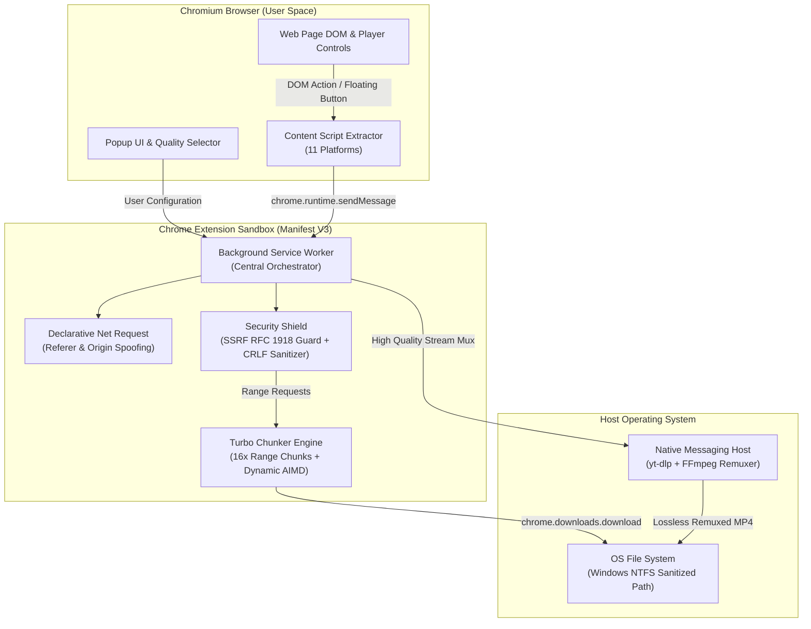

# Universal Media Downloader & Stream Extractor

[](https://developer.chrome.com/docs/extensions/mv3/intro/)
[-brightgreen.svg>)](test_extension.js)
[](package.json)
[](SECURITY.md)
[](eslint.config.mjs)
[](.prettierrc)
[](LICENSE)

High-performance, production-grade Google Chrome Extension (**Manifest V3**) dirancang untuk mengunduh video, stream HLS, manga, dan anime secara langsung, cepat, dan tanpa batas (_zero 403 Forbidden errors_) dari **11 platform populer** dengan format universal **H.264 (AVC) + AAC MP4** yang kompatibel langsung di seluruh pemutar media bawaan (Windows Media Player, QuickTime, Android, iOS, TV).

---

## ⚡ Core Engine & Keunggulan Utama

- **🚀 Turbo Chunker (Native 16x Multi-threading)**: Engine pengunduhan paralel berbasis _HTTP Range Requests_ dengan _Dynamic AIMD Concurrency_ (Additive Increase Multiplicative Decrease) untuk memaksimalkan throughput jaringan tanpa membebani browser.
- **🛡️ Multi-Layer Security Shield**: Dilengkapi proteksi SSRF (blokir IP privat RFC 1918 & loopback), sanitasi header CRLF, dan isolasi Declarative Net Request (DNR) dinamis untuk proteksi referer anti-hotlink.
- **🎯 Universal H.264/AAC Remuxing**: Mencegah masalah pemutaran "AV1 format not supported" pada Windows Media Player dengan integrasi remux audio-video lossless.
- **📦 Dynamic Batch & Estimated Size Calculator**: Kalkulator estimasi ukuran berkas interaktif pada batch modal (misal: AnoBoy) yang otomatis menghitung total download secara real-time.
- **⚡ Zero External Runtime Dependencies**: Seluruh runtime ekstensi dibangun murni menggunakan vanilla modern JavaScript tanpa ketergantungan library pihak ketiga.

---

## 🌐 Platform Support Matrix (11 Platform Aktif)

| Platform                | Fitur Utama                                                       | Format Output   | Mode Unduh                       |
| :---------------------- | :---------------------------------------------------------------- | :-------------- | :------------------------------- |
| **TikTok**              | Watermark-free video, slideshow HD, dan audio MP3                 | MP4 / MP3       | 1-Click Floating Button          |
| **Bstation / Bilibili** | Multi-track audio/video DASH, 1080p, bypass 403 referer           | MP4 (Remux)     | In-Player Bar & Batch Modal      |
| **YouTube**             | Watch & Shorts, selektor 1080p/720p/480p, dynamic size badge      | MP4 (H.264+AAC) | In-Player Dropdown & Native Host |
| **AnoBoy**              | Batch anime downloader, Blogger HD direct stream, size calculator | MP4 (Direct HD) | Batch Modal & Single Episode     |
| **JWPlyr**              | AES-128 HLS decryptor, custom IV auto-detect, folder downloader   | MP4 (Decrypted) | Folder Batch & Floating Action   |
| **TeraBox**             | High-speed multi-part direct stream resolver                      | Original Media  | Direct Stream Pipe               |
| **CosplayTele**         | Full-resolution cosplay photo set gallery archiver                | ZIP Archive     | 1-Click Gallery Pack             |
| **Pinterest**           | Original high-res video and photo asset retriever                 | MP4 / JPG / PNG | Media Action Button              |
| **Shinigami Manga**     | Bulk chapter downloader, canvas decryptor & image stitcher        | ZIP / Image Set | Chapter Batch Modal              |
| **Comic Translator**    | In-place OCR text detection & bilingual bubble translation        | Canvas Render   | Live Overlay                     |
| **Doodstream**          | Direct media stream resolver bypassing popups & anti-bot          | MP4 Stream      | 1-Click Direct Download          |

---

## 🏗️ Arsitektur Sistem (Mermaid Flowchart)



---

## 🚀 Panduan Memulai Cepat (Quickstart)

### 1. Clone Repositori

```bash
git clone https://github.com/AMillionDriver/Mungil-Extention-Downloader.git
cd Mungil-Extention-Downloader
npm install
```

### 2. Muat di Browser Chrome

1. Buka Google Chrome dan navigasikan ke URL: `chrome://extensions/`
2. Aktifkan sakelar **"Developer mode"** di pojok kanan atas.
3. Klik tombol **"Load unpacked"** (Muat yang belum dibongkar).
4. Pilih folder root repositori ini.

### 3. Pasang Native Host (Opsional untuk YouTube 1080p / High-Speed Remux)

Jalankan berkas batch installer bawaan untuk mendaftarkan native messaging host ke registry Windows:

```cmd
native_host\install_host.bat
```

---

## 🧪 Validasi Pengujian & Kualitas Kode

Ekstensi ini diverifikasi secara berkelanjutan menggunakan native test runner Node.js dengan **38 Test Suites (298 Test Cases)** tanpa kegagalan:

```bash
# Menjalankan seluruh test suites (38 suites, 298 assertions)
npm test

# Menjalankan pengujian ketahanan adversarial Bstation
npm run test:adversarial

# Memeriksa standar kode dan zero-warning policy
npm run lint

# Memeriksa konsistensi formatting
npm run format:check
```

---

## 📚 Panduan Dokumentasi Terkait

Untuk informasi lebih mendalam, pelajari dokumen pendukung berikut:

- 🤖 [**`AGENTS.md`**](AGENTS.md) — Aturan operasional dan invariant ketat untuk autonomous AI coding agents (Antigravity, Cursor, Codex).
- 📜 [**`llms.txt`**](llms.txt) — Indeks dan spesifikasi ringkas sesuai standar Answer.AI untuk parser AI.
- 🤝 [**`CONTRIBUTING.md`**](CONTRIBUTING.md) — Panduan kontribusi, arsitektur 4-layer, dan konvensi commit.
- 🔒 [**`SECURITY.md`**](SECURITY.md) — Kebijakan keamanan, model ancaman SSRF/CRLF, dan jalur pelaporan kerentanan.

---

## 📄 Lisensi

Didistribusikan di bawah lisensi **MIT**. Lihat berkas [`LICENSE`](LICENSE) untuk informasi lebih lanjut.
