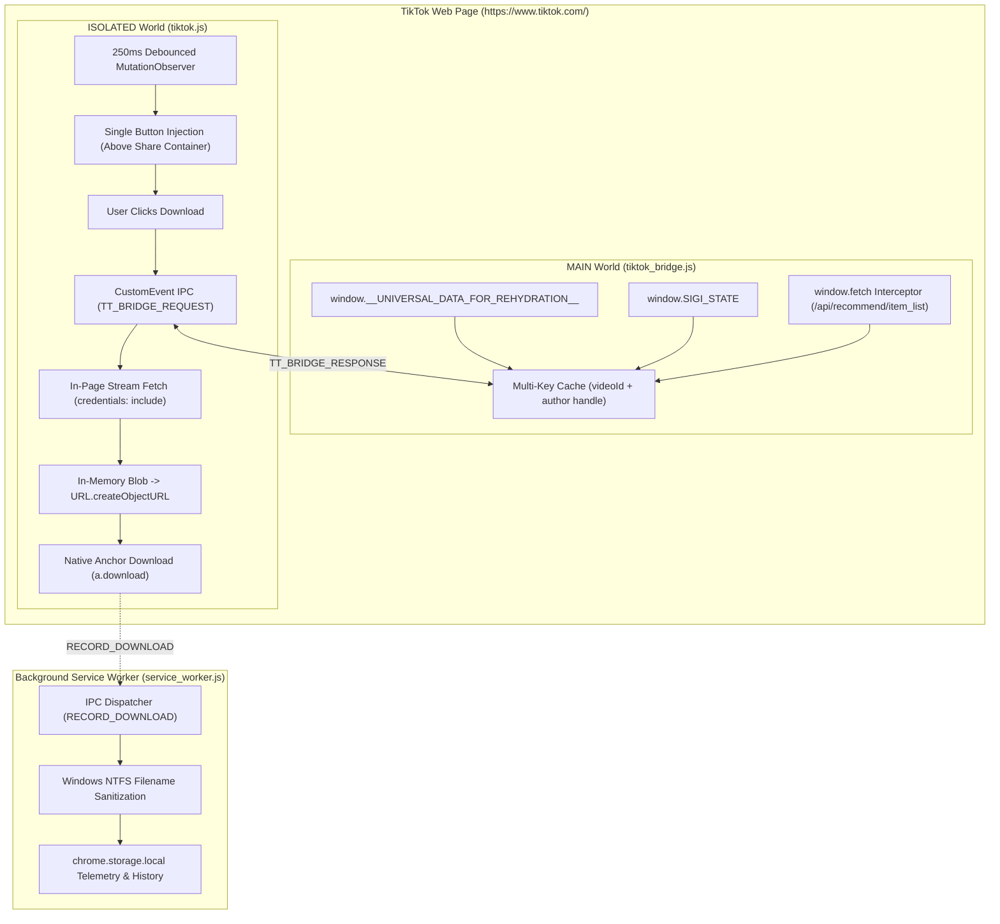

# TikTok Direct Downloader — Chrome Extension (Manifest V3)

[](https://developer.chrome.com/docs/extensions/mv3/intro/)
[](https://nodejs.org)
[](https://developer.mozilla.org/en-US/docs/Web/JavaScript)
[](test_extension.js)
[](LICENSE)

A lightweight, zero-build Google Chrome Extension built with pure Vanilla JavaScript (ES6+), HTML5, and CSS3 that enables direct, in-page 1-click downloading of TikTok videos in original MP4 quality without third-party downloader websites, watermarking servers, or ads.

---

## 🇮🇩 Panduan Ringkas (Bahasa Indonesia)

### Cara Cepat Pasang di Google Chrome
1. Buka browser Google Chrome dan buka alamat `chrome://extensions/`.
2. Aktifkan toggle **Mode Pengembang (Developer mode)** di pojok kanan atas.
3. Klik tombol **Muat yang belum dibongkar (Load unpacked)** di pojok kiri atas.
4. Pilih folder proyek ini:
   ```text
   C:\Users\flami\.gemini\antigravity\scratch\tiktok-direct-downloader-extension
   ```
5. Ekstensi **TikTok Direct Downloader** akan langsung aktif dan siap digunakan!

### Cara Menggunakan
1. Buka **[tiktok.com](https://www.tiktok.com/)** di Google Chrome.
2. Putar video mana pun di FYP, profil kreator, atau modal dialog.
3. Temukan tombol bundar **Download** yang bertengger rapi tepat **di atas tombol Share** (di bawah tombol Bookmark).
4. Klik tombol tersebut:
   - Tombol berubah menampilkan animasi berputar (`Fetching...` ➔ `Downloading...`).
   - File video asli berformat **`.mp4`** (misal: `tiktok_@creator_1234567890.mp4`) langsung tersimpan di folder Downloads komputer Anda!

---

## Key Features

- **Direct In-Page 1-Click Downloading**: Injects a clean, native-styled circular action button directly into TikTok's action bar between the Bookmark and Share buttons.
- **Anti-403 In-Page Fetch & Blob Pipeline**: Bypasses ByteDance CDN anti-hotlink restrictions by executing stream fetching directly within the active tab context (`https://www.tiktok.com/`) with authentic session credentials, eliminating corrupt `.htm` files and "File wasn't available on site" errors.
- **Multi-Tier Stream Extraction Engine**:
  - **Tier 1 (MAIN World Bridge)**: Injected at `document_start` to read `window.__UNIVERSAL_DATA_FOR_REHYDRATION__` and `window.SIGI_STATE`, plus a network hook on `window.fetch` to intercept highest-bitrate unwatermarked playback URLs.
  - **Tier 2 (HTML5 Video & DOM Resolution)**: Fallback parser extracting direct stream references while strictly excluding creator profile avatar images.
- **Strict Single-Button Guard**: Intelligent DOM reconciliation guarantees that exactly **one** download button is mounted per video card, preventing duplicate or stacked buttons upon infinite scrolling.
- **Windows NTFS Safe Naming**: Sanitizes author usernames and video IDs against all illegal Win32 characters (`\ / : * ? " < > |`), ASCII control characters, and reserved system names to enforce:
  ```text
  tiktok_@[author]_[id].mp4
  ```
- **Interactive 4-State Visual Lifecycle**:
  - **Idle**: High-contrast SVG download icon matching TikTok's native dark aesthetic.
  - **Loading**: Smooth spinning animation with button disabled to prevent duplicate download requests.
  - **Success**: Vibrant green checkmark icon for 2.5 seconds upon successful download initiation.
  - **Error**: High-visibility warning alert icon for 3.0 seconds if stream resolution fails, gracefully resetting to idle.
- **Extension Toolbar Popup**: Sleek popup interface providing one-click downloads for the active tab, real-time download counters, and direct shortcuts to the Downloads folder.
- **Zero-Build Architecture**: 100% pure standard web technologies. No Webpack, Vite, Rollup, or npm dependencies. Fully inspectable and auditable.

---

## Technical Architecture



### Why In-Page Blob Fetching Solves HTTP 403 Forbidden
Previous architectures that dispatched raw ByteDance CDN URLs to `chrome.downloads.download()` or attempted background `fetch()` in the service worker suffered from:
1. `chrome.downloads.download()` bypasses `declarativeNetRequest` header rewriting rules in Chromium.
2. In the `fetch()` API specification, `Referer` and `Origin` are *forbidden request headers* that browser security strips when called from extension service workers.
3. Without TikTok session cookies and an authentic `Referer: https://www.tiktok.com/`, ByteDance CDNs return **HTTP 403 Forbidden** (an HTML error document), which Chrome automatically renamed to `.htm`.

**The Solution:** Executing `fetch(streamUrl, { credentials: 'include' })` inside the Content Script leverages the active tab's origin and authentication cookies. The CDN serves the raw binary video (`200 OK`), which is converted into an in-memory `Blob` and downloaded natively via an Object URL.

---

## Button States & UI Design

The download button matches native TikTok action items (circular 48x48px container, semi-transparent background, and blurred backdrop filter):

| State | Visual Appearance | Label / Tooltip | Duration | Action |
|:---:|:---:|:---:|:---:|:---|
| **Idle** | Translucent white circle, download tray SVG | `Download` | Persistent | Ready for 1-click user download |
| **Loading** | Cyan accent ring, spinning SVG loader | `Extracting...` / `Downloading...` | Dynamic | Disables button, fetches stream & creates blob |
| **Success** | Green accent ring, SVG checkmark | `Saved!` | 2.5 seconds | Reverts cleanly back to Idle |
| **Error** | Red accent ring, SVG alert badge | `Failed` | 3.0 seconds | Reverts cleanly back to Idle for re-attempt |

---

## Project Structure

```text
tiktok-direct-downloader-extension/
├── manifest.json                  # Manifest V3 specification (permissions, host rules, scripts)
├── background/
│   └── service_worker.js          # Ephemeral SW: telemetry persistence, NTFS sanitization, fallback
├── content/
│   ├── platforms/
│   │   └── tiktok.js              # Content script: observer, single injection above Share, in-page fetch
│   ├── styles/
│   │   └── tiktok.css             # Native TikTok action bar styles, animations, & state transitions
│   └── injected/
│       └── tiktok_bridge.js       # MAIN-world bridge: universal data extraction & fetch hook
├── popup/
│   ├── popup.html                 # Extension toolbar popup layout
│   ├── popup.css                  # TikTok-dark themed popup styles
│   └── popup.js                   # Active tab triggers, lifetime telemetry, & folder links
├── icons/
│   ├── generate_icons.js          # Pure Node.js script generating RFC-compliant PNG icons
│   ├── icon16.png                 # 16x16 toolbar icon
│   ├── icon48.png                 # 48x48 extension management icon
│   └── icon128.png                # 128x128 Chrome Web Store icon
├── test_extension.js              # Automated E2E test runner (67 test cases across 7 suites)
├── PROJECT.md                     # Interface contracts and architectural specifications
└── README.md                      # Comprehensive user guide and technical documentation
```

---

## Installation Guide (Chrome Developer Mode)

1. Clone or download this repository to your local drive.
2. Open **Google Chrome** and navigate to `chrome://extensions/`.
3. In the upper-right corner, toggle **Developer mode** to **ON**.
4. In the upper-left toolbar, click **Load unpacked**.
5. Select the project root folder:
   ```text
   C:\Users\flami\.gemini\antigravity\scratch\tiktok-direct-downloader-extension
   ```
6. The extension **TikTok Direct Downloader** will now appear in your extensions list.
7. Click the Chrome Extensions puzzle icon in the top toolbar and pin the icon for quick access.

---

## How to Use

### Method 1: In-Page Single Action Button
1. Visit **[tiktok.com](https://www.tiktok.com/)**.
2. Browse through the **For You Page (FYP)**, user profiles, or click any video to open detail mode.
3. Click the circular **Download** button located directly above the **Share** button.
4. The video file will immediately download to your default Downloads folder.

### Method 2: Extension Toolbar Popup
1. While viewing any TikTok video tab, click the extension icon in Chrome's top toolbar.
2. Click **⬇ Unduh Video di Tab Ini**.
3. The extension identifies the active video and starts downloading immediately.

---

## Troubleshooting & FAQ

### Q1: Why did Chrome previously save files as `.htm` with "File wasn't available on site"?
**Answer:** This occurred when direct requests to ByteDance CDNs were blocked by anti-hotlinking protections (HTTP 403 Forbidden). Chrome detected the HTML error page response and renamed the download to `.htm`. This has been completely resolved via our **In-Page Fetch & Blob Pipeline**, which downloads the video within the authenticated page context.

### Q2: Are the console errors in DevTools (`sf16-website-login... 404`, `NotAllowedError: play()`) caused by the extension?
**Answer:** No. Those are internal TikTok telemetry scripts and standard browser autoplay policy restrictions built into TikTok's web client. The extension executes cleanly with zero runtime exceptions.

### Q3: How do I apply updates after editing code?
**Answer:** Go to `chrome://extensions/`, find **TikTok Direct Downloader**, and click the **Reload (circular arrow 🔄)** button. Then refresh your TikTok tab with `F5`.

---

## Automated Verification & Test Suite

The project includes an automated test harness with **zero external npm dependencies**:

```powershell
node test_extension.js
```

### Test Coverage (67/67 Tests Passing):
- **Suite 1: Manifest V3 Conformance & Schema Validation** (9 tests)
- **Suite 2: File Structure & PNG Asset Integrity** (2 tests)
- **Suite 3: JavaScript Syntax Verification via `node --check`** (6 tests)
- **Suite 4: Windows NTFS Filename Sanitization & Boundary Value Analysis** (9 tests)
- **Suite 5: In-Page UI Injection, Infinite Scrolling, & Deduplication** (11 tests)
- **Suite 6: Button State Transitions State Machine Simulation** (5 tests)
- **Suite 7: Service Worker IPC, Telemetry, & In-Page Blob Download** (25 tests)

To verify JavaScript syntax on individual source files:
```powershell
node --check background/service_worker.js
node --check content/platforms/tiktok.js
node --check content/injected/tiktok_bridge.js
node --check popup/popup.js
```

---

## License

This project is licensed under the **MIT License**. Built for personal productivity, research, and content creation workflows.
